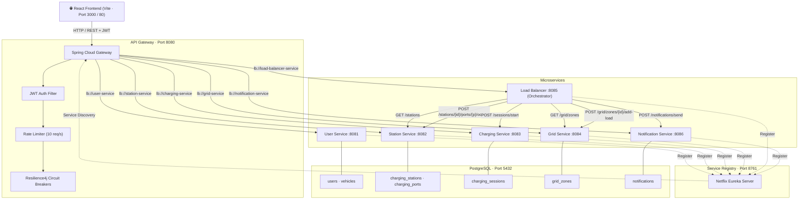
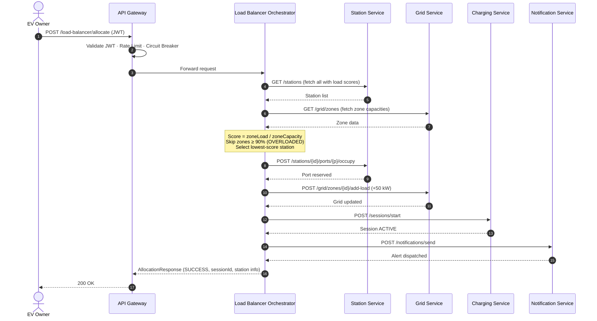

# ChargeSphere — Distributed EV Charging & Grid Load Balancing Platform

> **Architecture:** Microservices & SOA Orchestration  
> **Backend:** Java 17, Spring Boot 3.1.5, Spring Cloud 2022.0.4 (Eureka, Gateway, Resilience4j)  
> **Database:** PostgreSQL 14 / H2 In-Memory  
> **Frontend:** React 18 (Vite), Axios, Lucide Icons  
> **Deployment:** Docker Compose (local) · AWS EC2 (production)

---

## ⚡ Quick Start — Local (No Docker)

**Prerequisites:** JDK 17, Maven 3.9+, Node.js 18+, PostgreSQL 14+

```cmd
:: Start all microservices + frontend in one click
start-all.bat

:: Stop everything
stop-all.bat
```

| URL | Purpose |
|---|---|
| [http://localhost:3000](http://localhost:3000) | React Frontend |
| [http://localhost:8761](http://localhost:8761) | Eureka Service Registry |
| [http://localhost:8080](http://localhost:8080) | API Gateway |

**Demo credentials:**

| Role | Username | Password |
|---|---|---|
| EV User | `user` | `password123` |
| Admin | `admin` | `password123` |

---

## 🐳 Quick Start — Docker (Local)

**Prerequisites:** Docker Desktop running

```cmd
deploy-docker.bat
```

This builds all images locally and starts every container. Same URLs as above.

To stop:
```cmd
docker compose down
```

---

## ☁️ Production Deployment (AWS EC2)

### Step 1 — Build & Push Images (from your PC)

```powershell
.\build-and-push.ps1 -HubUser "your_dockerhub_username" -EC2IP "your_ec2_public_ip"
```

This builds all Spring Boot JARs + the React frontend (with the EC2 IP baked into the Vite build) and pushes every image to Docker Hub.

### Step 2 — Deploy on EC2

SSH into your instance and run:

```bash
# Copy docker-compose.prod.yml and .env to the server, then:
docker compose -f docker-compose.prod.yml up -d
```

**Create a `.env` file on the server** (see [`.env.example`](.env.example)):

```env
DOCKER_HUB_USERNAME=your_dockerhub_username
DB_PASSWORD=your_strong_password
JWT_SECRET=your_64char_secret_key
```

### EC2 Public Endpoints

| URL | Purpose |
|---|---|
| `http://<EC2-IP>` | React Frontend (port 80 via Nginx) |
| `http://<EC2-IP>:8080` | API Gateway |
| `http://<EC2-IP>:8761` | Eureka Dashboard |

> ⚠️ **AWS Learner Lab:** EC2 gets a new public IP every time the lab restarts (no Elastic IP). Re-run `build-and-push.ps1` with the new IP to rebuild the frontend image, then `docker compose pull frontend && docker compose up -d frontend` on EC2.

---

## 🏛 System Architecture



---

## 📋 Services

| Service | Port | Responsibility |
|---|---|---|
| **Service Registry** | `8761` | Netflix Eureka — dynamic instance registration & health tracking |
| **API Gateway** | `8080` | Routing, JWT auth, rate limiting, circuit breakers |
| **User Service** | `8081` | Registration, login (BCrypt + JWT), vehicle management |
| **Station Service** | `8082` | EV station & port inventory, port status (AVAILABLE / OCCUPIED) |
| **Charging Service** | `8083` | Session lifecycle (start / stop), energy & cost computation |
| **Grid Service** | `8084` | Zone capacity monitoring, overload detection (≥90%), load simulation |
| **Load Balancer** | `8085` | SOA Orchestrator — scoring algorithm, composite allocation workflow |
| **Notification Service** | `8086` | In-app alert dispatch & history |
| **React Frontend** | `3000/80` | SPA for EV drivers and grid administrators |

---

## 🔄 Smart Allocation Flow



---

## 🔒 Security

| Layer | Mechanism |
|---|---|
| **Password storage** | BCrypt (cost factor 10) — never stored plain |
| **Authentication** | JWT Access Token (24 h) + Refresh Token (7 days) |
| **Gateway enforcement** | `JwtAuthenticationFilter` validates every protected route |
| **Rate limiting** | Token bucket: 10 requests/sec per IP |
| **Circuit breakers** | Resilience4j on every downstream route with graceful 503 fallbacks |
| **CORS** | Configured in `CorsConfig.java` at gateway level |

Public (no JWT required): `POST /users/login`, `POST /users/register`  
Everything else requires a valid `Authorization: Bearer <token>` header.

---

## 🌐 REST API Reference

### User Service — `/users/**`
| Method | Path | Description |
|---|---|---|
| `POST` | `/users/register` | Register new user (returns JWT) |
| `POST` | `/users/login` | Login (returns access + refresh tokens) |
| `GET` | `/users/{id}` | Get user profile |
| `GET` | `/users/{userId}/vehicles` | List registered vehicles |
| `POST` | `/users/{userId}/vehicles` | Add a vehicle |

### Station Service — `/stations/**`
| Method | Path | Description |
|---|---|---|
| `GET` | `/stations` | List all stations with live port counts |
| `GET` | `/stations/{id}` | Station details & port statuses |
| `POST` | `/stations` | Create station *(Admin)* |
| `PUT` | `/stations/{id}` | Update station *(Admin)* |
| `DELETE` | `/stations/{id}` | Delete station *(Admin)* |
| `GET` | `/stations/{id}/availability` | Available port count |
| `POST` | `/stations/{id}/ports/{portId}/occupy` | Reserve a port |
| `POST` | `/stations/{id}/ports/{portId}/release` | Release a port |

### Grid Service — `/grid/**`
| Method | Path | Description |
|---|---|---|
| `GET` | `/grid/status` | System-wide load summary |
| `GET` | `/grid/zones` | All zones with current load |
| `GET` | `/grid/zones/{id}/load` | Zone load & status |
| `PUT` | `/grid/zones/{id}/load` | Set zone load (kW) |
| `POST` | `/grid/zones/{id}/add-load` | Increment zone load |
| `POST` | `/grid/zones/{id}/remove-load` | Decrement zone load |

### Load Balancer — `/load-balancer/**`
| Method | Path | Description |
|---|---|---|
| `POST` | `/load-balancer/select-station` | Score & rank stations (dry-run) |
| `POST` | `/load-balancer/allocate` | Full orchestrated allocation |
| `GET` | `/load-balancer/recommendations` | Quick station recommendations |

### Charging Service — `/sessions/**`
| Method | Path | Description |
|---|---|---|
| `POST` | `/sessions/start` | Start charging session |
| `POST` | `/sessions/stop` | Stop session, compute cost |
| `GET` | `/sessions/user/{userId}` | Session history |
| `GET` | `/sessions/user/{userId}/active` | Current active session |
| `GET` | `/sessions/stats` | Platform-wide stats |

### Notification Service — `/notifications/**`
| Method | Path | Description |
|---|---|---|
| `POST` | `/notifications/send` | Send alert |
| `GET` | `/notifications/user/{userId}` | User notifications |
| `PUT` | `/notifications/{id}/read` | Mark as read |

---

## 📂 Project Structure

```
SOA PROJECT/
├── api-gateway/               # Spring Cloud Gateway + JWT Filter + Circuit Breakers
├── service-registry/          # Netflix Eureka Server
├── user-service/              # Auth, BCrypt, JWT, Vehicles
├── station-service/           # Stations, Ports, Availability
├── charging-service/          # Session Lifecycle & Billing
├── grid-service/              # Zone Monitoring & Load Simulation
├── load-balancer-service/     # SOA Orchestrator & Scoring Algorithm
├── notification-service/      # In-App Alerts
├── frontend/                  # React 18 + Vite + Nginx (Docker)
│   ├── Dockerfile.frontend
│   └── nginx.conf
├── database/
│   ├── schema.sql             # PostgreSQL DDL (5 zones, 5 stations, 24 ports)
│   └── data.sql               # Seed data
├── Dockerfile.service         # Shared multi-stage Dockerfile for Spring Boot services
├── docker-compose.yml         # Local development (builds from source)
├── docker-compose.prod.yml    # Production (pulls from Docker Hub)
├── build-and-push.ps1         # Build all images & push to Docker Hub
├── deploy-docker.bat          # One-click local Docker deployment
├── docker-stop.bat            # Stop & remove all containers
├── start-all.bat              # Local bare-metal startup (no Docker)
├── stop-all.bat               # Kill all service processes
└── .env.example               # Environment variable template
```

---

## ⚙️ Environment Variables

| Variable | Required | Description |
|---|---|---|
| `DOCKER_HUB_USERNAME` | Production | Your Docker Hub username |
| `DB_PASSWORD` | Both | PostgreSQL password |
| `JWT_SECRET` | Both | JWT signing secret (min 32 chars) |

Copy `.env.example` to `.env` and fill in your values before deploying.
